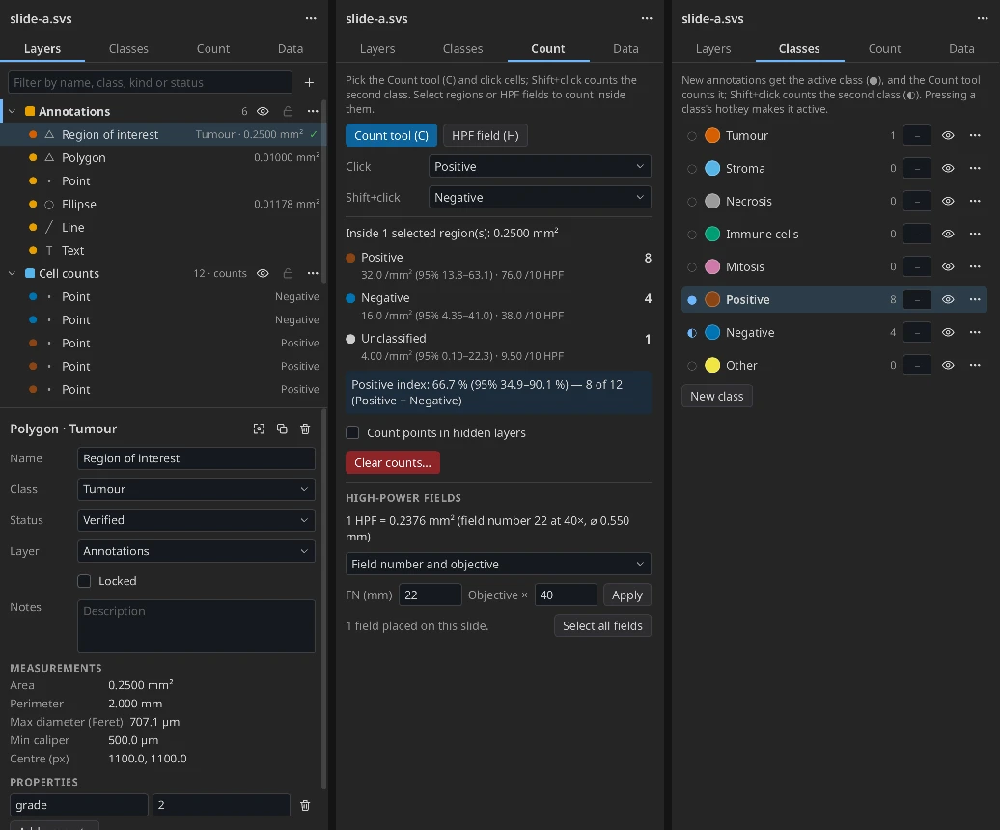
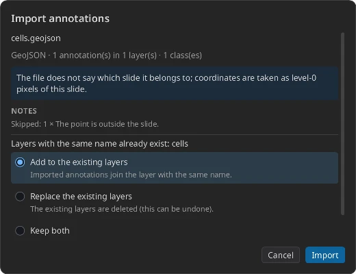

# Annotations plugin for eov

[](https://github.com/eosin-platform/eov-annotations-plugin/actions/workflows/ci.yml)
[](#license)

Annotations for [eov](https://github.com/eosin-platform/eov), the whole-slide
image viewer: points, regions, lines and text, reusable classes, cell
counting with densities and indices, high-power fields, measurements in
physical units, comment threads, blinded copies and reader comparison for
multi-reader studies, and import and export in the formats other tools use
(GeoJSON as QuPath writes it, ASAP and Aperio ImageScope XML, DICOM
Microscopy Bulk Simple Annotations; Hamamatsu NDPA import).

Version 1.0 of the plugin is written for eov 1.x (plugin API 1.0).

<p align="center">
  
</p>

- [Installing](#installing)
- [Using it](#using-it)
- [Formats](#formats)
- [Coordinates and units](#coordinates-and-units)
- [Where annotations are stored](#where-annotations-are-stored)
- [Building, testing and packaging](#building-testing-and-packaging)
- [Limitations](#limitations)

## Installing

```bash
eov plugin install annotations     # the official release for this platform
eov plugin info annotations        # version, compatibility, provenance
```

Packages are also attached to the
[releases](https://github.com/eosin-platform/eov-annotations-plugin/releases).
A package you downloaded or built yourself installs with `--force`, because
it replaces the official source of the `annotations` id:

```bash
eov plugin install --force annotations-v1.0.0-linux-x86_64.eop
```

The package declares `api = ">=1.0, <2"` and `[environment] version =
">=1.0.0, <2.0.0"`; eov refuses it outside that range.

## Using it

Open a slide and click **Annotations** in the toolbar to show the panel. It
has four tabs:

- **Layers**: the annotations of the active slide, grouped in layers, and
  the details of the selection;
- **Classes**: the classes shared by all slides;
- **Count**: cell counts, densities and the high-power field size;
- **Data**: import and export, blinded copies and comparison with a second
  reader, backups, the database, other slides and settings.

### Tools

The tools are in eov's toolbar; each has a key.

| Tool | Key | What it does |
|---|---|---|
| Select | `V` | Click to select, drag to select several; drag an annotation or its handles to move or reshape it. `Delete` deletes, `Esc` clears the selection. |
| Point | `.` | A point annotation. |
| Count | `C` | A count point in the *Cell counts* layer with the class counted by a click; **Shift+click** counts the second class. |
| Polygon | `P` | Click the vertices; click the first vertex, double-click or press Enter to close it. |
| Freehand | `G` | Drag an outline (stored as a polygon). |
| Brush | `S` | Paint with a round brush: over a selected region to extend it, elsewhere to make a new one. **Alt** (or the eraser setting) erases from the selected region. `[` and `]` change the size. |
| Rectangle | `B` | Drag a rectangle. |
| Ellipse | `O` | Drag an ellipse. |
| Line / path | `L` | Click the vertices; double-click or Enter finishes. Its length is measured. |
| Arrow | `A` | Like a line, with a head at the last point: click the tail, double-click the tip. |
| Text | `T` | A text label; its text is the annotation's name. |
| HPF field | `H` | A dashed field of the configured size follows the pointer; a click places one in the *HPF fields* layer, a drag pans. |

With one region selected, drawing a polygon, freehand outline, rectangle
or ellipse with **Shift** adds the shape to that region and with **Alt**
(or Ctrl/⌘) cuts it out of the region, which makes holes (an excluded lumen
no longer counts as area) or splits the region. A brush stroke is the
union of the discs stamped along it, simplified to a quarter of a screen
pixel; its size is in screen pixels (Data tab), so it paints finer when
zoomed in, and each stroke is one undo step. Outlines that cross
themselves are split into simple parts when they are drawn, and every shape
is clipped to the slide.

Right-clicking the slide offers: show the annotation in the panel, copy its
measurements, lock or unlock it, delete it, add a point or place an HPF
field at the cursor, and open the panel. The eye button in a view's HUD
hides or shows the slide's annotations in that view only.

Every change (drawing, editing, deleting, an import, deleting a layer or a
class) is one step in eov's undo history, **Ctrl+Z** / **Ctrl+Shift+Z** (⌘ on
macOS). Undo applies to the slide the change was made on.

### Layers and annotations

New annotations go into the layer marked with a bar on the left (click a
layer to choose it); if a slide has none, an *Annotations* layer is created.
Count points and HPF fields have their own layers. A layer can be hidden,
locked (no editing, deleting or moving of its annotations), recoloured,
renamed, given notes and an opacity, or deleted (with undo) from its `⋯`
settings.

Select an annotation on the slide or in the list to see its details: name,
class, review status (*draft*, *verified*, *rejected*), layer, lock,
description, measurements, free-form properties (name–value pairs),
comments, its author and when it was created and last edited. Comments
form a thread under the annotation, each with its author (the *Author*
setting) and time; they can be added to locked annotations too, deleted
(with undo), and the list shows how many an annotation has. Changes apply to all
selected annotations where that makes sense. Text fields save as you type
(after a pause, on Enter or when you leave the field), to the annotation
they were typed for. Double-click a row to zoom to it; Ctrl+click selects
several. The filter matches names, classes, kinds and statuses; large
layers start collapsed and long lists are shown a few hundred rows at a
time. Which layers you collapse or expand is remembered with the slide.

### Classes

Classes (Tumour, Stroma, Necrosis, Immune cells, Mitosis, Positive,
Negative and Other to begin with) are shared by all slides. Each has a
colour, an optional one-key hotkey, visibility and opacity, and shows how
many annotations of the active slide use it. Click a class to make it the
*active class*: new annotations get it and the Count tool counts it.
Pressing a class's hotkey makes it active; a hotkey is one character that
eov and the annotation tools do not use. If another plugin already uses
the key, eov says so and the class shows why its key does not work.
The second count class (Shift+click with the Count tool) is chosen in the
class's `⋯` settings or in the Count tab. Deleting a class leaves its
annotations unclassified (with undo).

### Counting

Pick the classes counted by a click, by Shift+click and (optionally) by
Alt+click in the Count tab, choose the Count tool and click cells. The
tally counts the point annotations of the visible layers (optionally of
hidden layers too):

- with no region selected, on the whole slide;
- with regions or HPF fields selected, inside their union, with the area,
  the density per mm² with its exact 95 % Poisson (Garwood) interval, and
  the count per 10 HPF (or per field, when only fields are selected);
- with two count classes, the index *first / (first + second)* with its
  exact 95 % (Clopper–Pearson) interval, e.g. the Ki-67 proliferation index
  with *Positive* and *Negative*, or the PD-L1 tumour proportion score;
- with an Alt+click class as well, the PD-L1 combined positive score:
  (click + Alt+click counts) per 100 tumour cells (click + Shift+click
  counts), i.e. positive tumour and immune cells over all tumour cells. It
  is shown with one decimal, so a value next to a cut-off is not rounded
  across it, capped at 100, and flagged below 100 tumour cells. On desktops
  where Alt+click moves windows, change that modifier in the window
  manager, or make the immune class active with its hotkey while counting
  it.

Counts follow every edit at once, and areas use the same even-odd rule as
the point-in-region test and the display. **Clear counts…** removes the
count points of the slide (with undo).

### High-power fields

The field size is given as a field number and objective (the default is
FN 22 at 40×, 0.2376 mm²) or directly as an area in mm². With the HPF
field tool active, a field outline follows the pointer, labelled with what
it would count; click to place a field, drag to pan, use the wheel to zoom.
Placed fields are ordinary regions in the *HPF fields* layer: select them
(**Select all fields**) to count inside them. Without a pixel size, fields
cannot be sized and are refused. The tool uses no keys of its own: eov's
shortcuts, the other tools' keys and class hotkeys work as usual while it
is active, and **Esc** (or `H` again) leaves it.

### Measurements

Every annotation lists, as the slide's pixel size allows:

- area (minus holes) and perimeter, or length for lines;
- maximum diameter (Feret) and minimum caliper (minimum Feret width);
- the centre in level-0 pixels.

Values are computed in micrometre space, so slides with different
horizontal and vertical pixel sizes are measured exactly. With only one
pixel size known it is used for both axes and the values are marked
approximate (≈). With none, values are given in pixels and the panel says
so. **Copy measurements** copies them as tab-separated text; the CSV export
has them for every annotation.

### Second readers

For studies where two people read the same slides (Data → *Second reader*,
or `⋯`):

- **Blinded copy…** writes an eov JSON file of the slide's **visible**
  layers (hide the others first): their shapes, classes and names, HPF
  fields included, without authors, comments, statuses, descriptions,
  properties, locks, layer notes or times, without the slide's file name
  and without the exporter's name and organisation. It keeps the slide's
  identity, so the second reader imports it onto the same slide, and says
  `"blinded": true` in its metadata.
- **Compare…** reads another reader's export (any format the plugin
  imports) and compares it with the visible layers of the open slide, HPF
  fields left out. For each class it shows how many points and regions
  each reader has, how many points match (one to one, nearest pairs first,
  within 10 µm, or 40 px on a slide without a pixel size) with
  F1 = 2 · matched / (n₁ + n₂), and how much the readers' regions overlap
  as the Dice coefficient 2 · |A ∩ B| / (|A| + |B|) of each reader's union
  of regions; a last row compares all regions whatever their class. Lines,
  arrows and text are not compared, and regions are compared by area, not
  paired one by one. **Again** compares with the same file after edits.
  Comparing writes nothing to the database.

## Formats

| Format | Import | Export |
|---|---|---|
| GeoJSON (QuPath and others) | ✓ | ✓ |
| eov JSON (format 2; format 1 of the plugin before 1.0) | ✓ | ✓ |
| eov archive (every slide in the database) | ✓ (one slide) | ✓ |
| ASAP XML | ✓ | ✓ |
| Aperio ImageScope XML | ✓ | ✓ |
| Hamamatsu NDPA (NDP.view) | ✓ | |
| DICOM Microscopy Bulk Simple Annotations (`.dcm`) | ✓ (2D) | ✓ |
| CSV measurements | | ✓ |

**Importing** (Data → Import…, or `⋯` → Import annotations…) reads the file
in the background and shows a preview before anything is written: what was
found, whether the file was made for this slide (by eov slide identity,
OpenSlide quickhash, size or SHA-256, as far as the file says), what had to
be skipped or repaired and why, and what to do with layers whose names
already exist (add to them, replace them, or keep both). The import is
then written in one transaction and is one undo step. It stays bound to the
slide it was started on and is cancelled if that slide is closed.
Unusable elements (bad coordinates, too few vertices, shapes outside the
slide) are skipped with a reason; crossing outlines are repaired; overlong
names and texts are cut to the limits.

<p align="center">
  
</p>

- **GeoJSON**: Points, LineStrings and Polygons (with holes), their Multi
  forms and GeometryCollections, as Features or a FeatureCollection. QuPath's
  `classification` (`name` and `color`, or `names` and `colorRGB` of older
  versions) becomes the class, `name`, `isLocked` and `metadata` are kept;
  detections go to a separate layer. Exports are FeatureCollections that
  QuPath reads; rectangles and ellipses are written as polygons, text as
  points, and `properties.eov` keeps the exact shape, layer, status,
  comments and provenance so a round trip through eov loses nothing.
- **eov JSON**: self-describing (`format`, `format_version`, the coordinate
  convention, the slide's identity, quickhash, size, pixel size and
  bounds), with classes, layers and every annotation field, comments
  included.
- **ASAP XML**: dots, point sets, rectangles, polygons, splines (as
  their control polygon) and measurements (as lines); groups become
  classes. Exports write classes as groups and ASAP's nearest shape for what
  it lacks (ellipses as polygons, lines and arrows as measurements, text as
  dots, holes as polygons of their own), with `Eov…` attributes ASAP
  ignores and eov reads back, so layers, holes, ellipses, arrows and text
  survive a round trip.
- **ImageScope XML**: each annotation becomes a layer, `LineColor` its
  colour; polygon and freehand, rectangle, ellipse, point, ruler (a line)
  and arrow (from its first vertex to its last) regions; negative regions
  become holes of the region that contains them. Exports write one
  annotation per layer and one region per annotation (holes as negative
  regions), with the class and description as region attributes.
- **NDPA** (NDP.view): freehand outlines and lines, rectangles, circles,
  pins and arrows, with their titles and details; one layer per colour.
  NDPA coordinates are nanometres measured from the centre of the glass
  slide, so they are placed with the open slide's NDPI properties
  (`hamamatsu.XOffsetFromSlideCentre` / `YOffsetFromSlideCentre`) and pixel
  size: `x_px = (x_nm − XOffset) / (mpp · 1000) + width / 2`, likewise y.
  If the slide is not an NDPI or lacks those properties, the preview says
  so and nothing is imported.
- **DICOM** (Microscopy Bulk Simple Annotations, the annotation objects of
  DICOM whole-slide imaging: SOP class 1.2.840.10008.5.1.4.1.1.91.1,
  modality ANN). A DICOM annotation group has one graphic type and one
  property type, so an export has a group per layer, class and kind of
  shape, labelled with the class (or with the layer, for unclassified
  annotations), described with the layer's name and coloured with the
  class colour (Recommended Display CIELab Value). Points and the anchors
  of text labels are POINTs, lines and arrows (tail to tip) POLYLINEs,
  polygons POLYGONs (their outer ring), rectangles RECTANGLEs and ellipses
  ELLIPSEs (the ends of the major axis, then of the minor axis). Every
  group's property category and type is SCT 91723000 "Anatomical
  Structure": eov classes are names rather than codes, so a generic code
  says nothing wrong about what was drawn, and the class stays the label.
  Coordinates are (column, row) pairs in 32-bit floats (finer than
  0.01 px on slides of up to 100 000 px), in the total pixel matrix (Pixel
  Origin Interpretation VOLUME), with lines and polygons located by a
  1-based Long Primitive Point Index List.
  - *References.* When the slide is a DICOM image (OpenSlide publishes its
    attributes as `dicom.*` properties), the export joins the slide's
    study, with its patient and study attributes, shares its frame of
    reference, and refers to its image and series. Otherwise the file is a
    study of its own with empty patient attributes (nothing identifying is
    made up) that refers to no image, so DICOM viewers cannot attach it to a
    slide by themselves.
  - *What other viewers do not see.* DICOM bulk annotations have no holes,
    text, arrowheads or annotation names: other viewers show regions
    without their holes, text labels as points and arrows as lines. eov
    keeps holes, texts, arrows, layers, names, descriptions and statuses in
    private attributes (creator `EOV ANNOTATIONS`) that it reads back, and
    the export's notice lists what was left out for other viewers.
    Authors, comments, properties and times are not exported.
  - *Importing.* Files of other producers are read when their coordinates
    are 2D (32- or 64-bit, any of the five graphic types): each group
    becomes a layer named after its label (groups with the same label
    share one), the label (or, without one, the property type's meaning)
    the class of its annotations, and its measurements become annotation
    properties; rectangles and ellipses that are not axis-aligned become
    polygons. A file that refers to a DICOM image is checked against the
    open slide's series and instance. 3D annotations (millimetres in the
    slide's frame of reference) and coordinates relative to single frames
    are refused with the reason, as are DICOM files that hold no
    annotations (slide images, structured reports).
- **CSV**: one row per annotation with its layer, class, kind, status,
  author, timestamps, centre and measurements in µm and pixels, whether
  the slide was calibrated, and how many comments it has. Cells that a spreadsheet would run as formulas
  are escaped.

Blinded copies for a second reader are eov JSON files without authors,
comments and statuses (see [Second readers](#second-readers)).

Exports never contain the slide's path. The file name is included only
when *Include the slide's file name in exports* is set; the author,
organization, project and license fields are written into eov JSON
exports (DICOM exports use the author, organization and project as the
content creator, institution and content description). DICOM exports of
a DICOM slide carry the slide's patient and study attributes, as the
objects of one DICOM study must. Files are written to a temporary file
first and renamed into place, so an interrupted export never leaves a
half-written file.

## Coordinates and units

All coordinates, in the database and in every format, are **level-0 pixels**
of the slide: the origin is the top-left corner of the level-0 image, x
grows to the right and **y grows downwards** (the convention of OpenSlide,
QuPath, ASAP and ImageScope, and of eov's plugin API). DICOM's 2D image
coordinates have the same convention: (0, 0) is the top-left corner of
the top-left pixel, whose centre is (0.5, 0.5), and (columns, rows) the
bottom-right corner of the image, so they are written and read
unchanged. The OpenSlide bounds offset (`openslide.bounds-x/y`) is **not**
subtracted: coordinates refer to the full level-0 image, and eov JSON
exports record the bounds so that tools working in the bounds' frame can
convert. Physical values use the slide's pixel size (µm per level-0 pixel,
`mpp_x` and `mpp_y`), also recorded in eov exports.

## Where annotations are stored

Annotations live in one SQLite database, `annotations.db` in the plugin's
data directory, `<eov data>/plugins/annotations/`, where `<eov data>` is
`$EOV_DATA_DIR` or the platform's local data directory plus `eov`:

| Platform | Default location |
|---|---|
| Linux | `~/.local/share/eov/plugins/annotations/annotations.db` |
| macOS | `~/Library/Application Support/eov/plugins/annotations/annotations.db` |
| Windows | `%LOCALAPPDATA%\eov\plugins\annotations\annotations.db` |

To use another file (for example a shared one), set `"database_path"` in the
plugin's settings file next to it (`settings.json`, while eov is closed), or
the `EOV_ANNOTATIONS_DB` environment variable. The Data tab shows the file
in use.

- **Several eov windows** can use the same database: it runs in WAL mode,
  every change is one transaction checked against what it changes, and a
  window picks up the other's changes when it is focused.
- **Read-only databases** (a teaching set on a read-only share) open
  read-only: annotations can be viewed and exported, not edited. An older
  read-only database is upgraded in a private copy.
- **Slides** are recognised by eov's slide identity, not by their path, so
  annotations follow a slide that is moved or renamed. A slide that was
  re-saved or de-identified gets a new identity; **Other slides** in the
  Data tab lists the slides with annotations that are not open, and
  **Attach** moves their annotations to the open slide (with undo).
- **Copies** of a slide file have the same identity, so they show and edit
  the same annotations; the plugin says so when a copy (or a renamed file)
  opens with annotations made under another name. For an independent
  second read, give the reader a blinded copy (see above).
- **Deleted** annotations, layers and classes are kept for undo and removed
  for good after seven days. Every change is also recorded, with its author
  and time, in an `audit_log` table; comments are recorded there with their
  text.
- **Backups**: **Back up…** writes a consistent copy of the database (also
  while eov is using it), **Export all slides…** writes every slide to one
  eov archive (JSON), and **Merge…** brings the annotations of another
  database (a backup, or a colleague's) into this one without overwriting
  anything.
- **The schema is versioned** (`PRAGMA user_version`, now 3: version 3 added
  comments) and upgraded in one transaction when an older database is
  opened.

### Coming from the plugin before 1.0

Before eov 1.0 the plugin kept its database in eov's settings folder
(`~/.config/eov/annotations.db` on Linux, `~/Library/Application
Support/eov/annotations.db` on macOS, `%APPDATA%\eov\annotations.db` on
Windows). eov tells the plugin where that folder is; when it holds an
`annotations.db`, the plugin offers once, at start, to bring its
annotations into the current database (the old file is only read), and the
Data tab keeps offering it until it is done. **Merge…** in the Data tab
does the same for any other database file. You can also point
`database_path` at the old file to keep using it (it is upgraded in place,
after which older versions of the plugin cannot read it, so back it up
first).
Slides of the old database are recognised by their old sampled fingerprint
the first time they are opened (computed in the background) and linked to
their eov identity from then on. Exports of the old plugin (format 1) can
be imported as well.

## Translations

The plugin follows the language of eov's interface (eov 1.1 and later):
the panel, the import dialog, tool names, tooltips, menus, messages and
undo entries are translated, and they change with the language chosen in
eov. What is written to files and to the database is not translated:
exports, the audit trail, and the names given to new layers and classes
stay English.

The translations are gettext catalogs,
`translations/<tag>/LC_MESSAGES/annotations.po`, one per language (`de`,
`pt-BR`, `zh-Hant`, …; see `[i18n]` in `plugin.toml`); a text a catalog
lacks shows in English. The eov repository's `tools/i18n/i18n.py` extracts
the texts (`@tr` in `ui/*.slint`, `tr!` in the Rust code) and creates and
updates the catalogs. Corrections of a translation are welcome as issues or
pull requests.

## Building, testing and packaging

The plugin builds on its own (it is not a member of eov's workspace) and
needs only `eov-plugin-api`, found at `../../plugin_api` (where it is inside
an eov checkout, under `plugins/annotations`).

```bash
cargo build --release                 # target/release/libannotations.so (.dylib, annotations.dll)
cargo test                            # unit and end-to-end tests (SDK mock host, temporary directories)
cargo clippy --all-targets -- -D warnings
cargo fmt --check
```

The tests drive the plugin through the same FFI adapter eov uses, with the
SDK's mock host; they only touch temporary directories.

Two development tools check what the unit tests cannot:

```bash
cargo run --release --manifest-path tools/ui-check/Cargo.toml                        # check the .slint surfaces
cargo run --release --manifest-path tools/ui-check/Cargo.toml --bin ui-render -- out  # draw them into PNGs
cargo run --release --manifest-path tools/load-check/Cargo.toml                      # load the built library like eov
```

`tools/ui-check` uses the Slint version eov 1.0 compiles plugin surfaces
with (1.19.0). It compiles `ui/*.slint` as the host does and verifies that
the components declare exactly the callbacks the plugin handles (with the
argument types it reads), that every property the plugin pushes in a range
of realistic states is a public input of the right type (struct fields
included) and that every input is pushed, and it presses a few controls
through the accessibility tree; `ui-render` draws those states with Slint's
software renderer (the screenshots above). `tools/load-check` opens the
release library with abi_stable's layout checks and the API version
handshake, as eov does, and draws an annotation through it.

To package (an `.eop` is a tar archive with `plugin.toml`, the library,
`ui/` and the translation catalogs (`translations/<tag>/LC_MESSAGES/*.po`)
at its root; entries are sorted and dated `SOURCE_DATE_EPOCH`, so builds
are reproducible):

```bash
python3 scripts/package_eop.py --output dist/annotations-v1.0.0-linux-x86_64.eop
eov plugin install --force dist/annotations-v1.0.0-linux-x86_64.eop
```

`scripts/package_eop.py --check-only` validates the manifest, `ui/` and the
catalogs without a library. In an eov checkout, `scripts/run-with-plugins.sh` of eov
starts a development build with the plugins in a separate eov home.

CI (`.github/workflows/ci.yml`) runs formatting, clippy, the tests, the
surface check, the load check and the packaging script against eov's
`plugin_api` on Linux, macOS and Windows. Releases
(`release.yml`, dispatched with `scripts/dispatch-release-workflow.sh
<version>`) build the six platform packages, write `release.toml` with
their SHA-256 hashes and immutable URLs, and publish them.

## Limitations

This depends on what eov's plugin API offers today:

- A region made of several separate parts is stored as several
  annotations (eov's shapes have no multipolygon).

Not done yet: DICOM structured reports (SR) are neither read nor
written, and DICOM bulk annotations in 3D slide coordinates or relative to
single frames are refused (see [Formats](#formats)).

## Repository layout

```text
plugin.toml         the manifest
src/
  lib.rs            the plugin: events, tools, menus, surfaces
  core.rs           state, the database and I/O threads, operations
  actions.rs        drawing, editing, layers, classes, HPF fields
  overlay.rs        what is drawn on the slide (eov overlay layers)
  sidebar.rs        the panel's properties and callbacks
  transfer.rs       import preview and apply, exports, backups
  counting.rs stats.rs measure.rs geometry.rs
  compare.rs        comparing two readers
  formats/          GeoJSON, eov JSON, ASAP/ImageScope XML, NDPA, CSV,
                    DICOM (with a small Part 10 reader and writer)
  db/               schema, migrations (also from before 1.0), queries
  tests.rs          end-to-end tests
tests/language.rs   following eov's language (a test binary of its own)
ui/                 the panel and the import dialog (Slint)
translations/       gettext catalogs, <tag>/LC_MESSAGES/annotations.po
tools/ui-check/     surface check and renderer (Slint 1.19.0)
tools/load-check/   loads the built library like eov
scripts/            packaging and release tooling
```

## License

This repository is tri-licensed under MIT, Apache-2.0 or GPL-3.0, at your
option; see `LICENSE-MIT`, `LICENSE-APACHE-2.0` and `LICENSE-GPLv3`.
